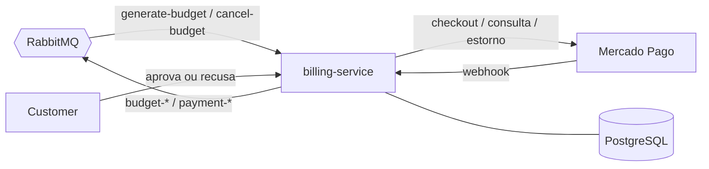

# oficina-billing-service

Microsserviço de **Orçamento e Pagamento** da oficina. Gera o orçamento da ordem de serviço, recebe a aprovação ou recusa do cliente, cobra via **Mercado Pago** e estorna o pagamento quando a Saga precisa compensar.

## Responsabilidades

- Gerar o orçamento a partir do comando da Saga e avisar o cliente por e-mail.
- Receber a decisão do cliente (`POST /budgets/:orderId/decision`).
- Criar o checkout no Mercado Pago e enviar o link de pagamento.
- Receber o webhook de pagamento (`POST /payments/webhook`), consultar o pagamento no provedor e informar a Saga.
- Cancelar o orçamento ou estornar o pagamento como compensação.

## Tecnologias

NestJS 11, TypeScript, Prisma, PostgreSQL, RabbitMQ, SDK Mercado Pago, Jest, Cucumber, New Relic, Docker, Kubernetes.

**Por que PostgreSQL:** orçamento e pagamento são dados financeiros, que pedem consistência forte, unicidade por OS e auditoria simples.

## Arquitetura

Clean Architecture: `domain` (agregado `Budget` e suas transições), `application` (casos de uso e portas), `infrastructure` (Prisma, RabbitMQ, Mercado Pago, SMTP) e `presentation` (controllers e validação da assinatura do webhook).



## Participação na Saga

| Recebe | Publica |
|---|---|
| `billing.command.generate-budget` | `budget-generated` ou `budget-generation-failed` |
| decisão do cliente | `budget-approved` (com link de pagamento) ou `budget-rejected` |
| webhook do Mercado Pago | `payment-confirmed` ou `payment-failed` |
| `billing.command.cancel-budget` | `payment-refunded` (se já pago) ou `budget-cancelled` |

Status do orçamento: `PENDING_APPROVAL` → `AWAITING_PAYMENT` → `PAID`, com os desfechos `REJECTED`, `PAYMENT_FAILED`, `REFUNDED` e `CANCELLED`. Comandos e notificações repetidos são tratados de forma idempotente.

## Mercado Pago

Com `MERCADOPAGO_ACCESS_TOKEN` definido, o serviço usa o Checkout Pro: cria a preferência com `external_reference` igual ao id da OS, recebe a notificação, consulta o pagamento e, se necessário, cria o estorno. Configure também `MERCADOPAGO_NOTIFICATION_URL` (URL pública de `/payments/webhook`) e, opcionalmente, `MERCADOPAGO_WEBHOOK_SECRET` para validar a assinatura `x-signature`.

Sem o token, entra o **gateway simulado**, para desenvolvimento local. Nele o webhook aceita o id `approved:<orderId>` ou `rejected:<orderId>`:

```bash
curl -X POST http://localhost:3002/payments/webhook -H "Content-Type: application/json" -d '{"type":"payment","data":{"id":"approved:<orderId>"}}'
```

## Execução local

```bash
docker compose up --build
```

A API sobe em `http://localhost:3002` e o Swagger em `http://localhost:3002/docs/billing`. Para o fluxo completo, use o `docker-compose.yml` em `oficina-infra-k8s/local`.

## Testes

```bash
npm run test:cov
```

```bash
npm run test:bdd
```

Cobertura atual: **98% de linhas** (25 testes) e 3 cenários BDD: orçamento aprovado e pago, pagamento recusado e estorno como compensação.

## Deploy

Mesma pipeline dos demais microsserviços: qualidade em todo pull request, deploy em `oficina-hml` a partir de `develop` e em `oficina-prod` a partir de `main`.

| Tipo | Nome |
|---|---|
| Secrets | `AWS_ACCESS_KEY_ID`, `AWS_SECRET_ACCESS_KEY`, `SONAR_TOKEN`, `DATABASE_URL`, `RABBITMQ_URL`, `JWT_SECRET`, `MERCADOPAGO_ACCESS_TOKEN`, `MERCADOPAGO_WEBHOOK_SECRET`, `NEW_RELIC_LICENSE_KEY`, `SMTP_HOST`, `SMTP_PORT`, `SMTP_USER`, `SMTP_PASSWORD` |
| Variables | `AWS_REGION`, `EKS_CLUSTER`, `SONAR_PROJECT_KEY`, `SONAR_ORGANIZATION`, `MERCADOPAGO_NOTIFICATION_URL` |

## Observabilidade

Logs em JSON com `correlationId`, agente New Relic e evento `IntegrationFailure` a cada falha do Mercado Pago ou do SMTP, usado no dashboard de erros de integração e nos alertas.

## APIs

Swagger em `/docs/billing` e collection do Postman em `oficina.postman_collection.json`.
